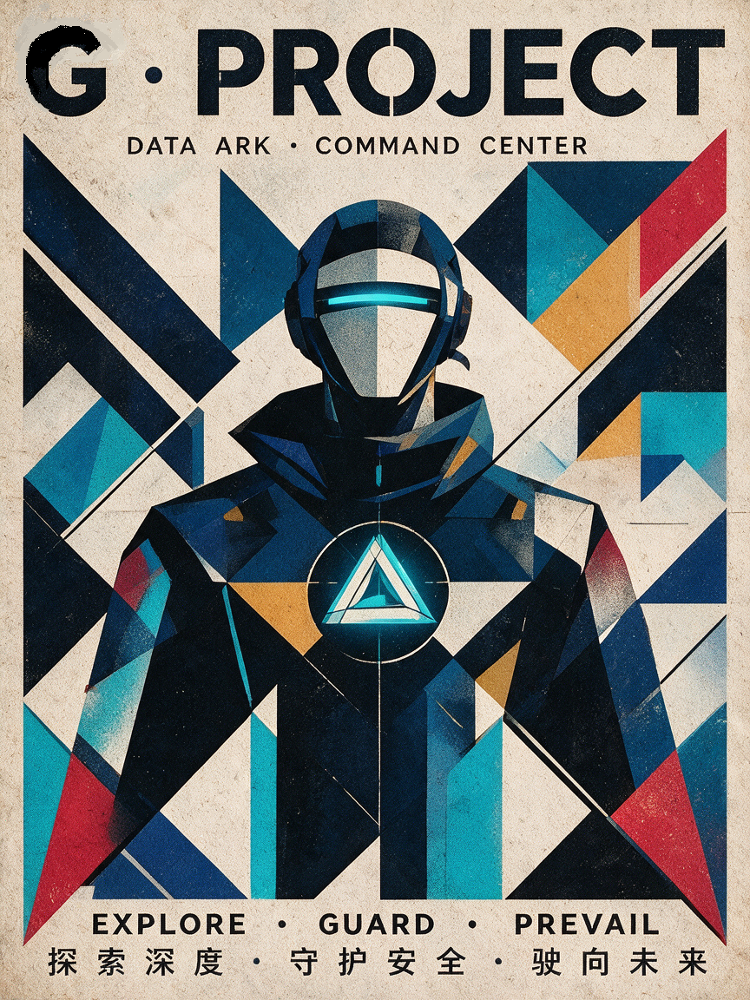

# G计划 · 数据方舟

> 指挥官的数字生活中枢

一艘航行在数据与现实交界处的方舟。三位乘员各司其职，守护指挥官的每一天。

---

## 📦 下载

[**前往 Releases 下载最新版 →**](https://github.com/tafei-niubi/plan-G/releases)

- **便携版**（`G计划 x.x.x.exe`）：双击即用，无需安装
- **安装版**（`G计划 Setup x.x.x.exe`）：安装后自动创建桌面快捷方式

> ⚠️ 首次运行如被 Windows Defender / 360 拦截，请选择「仍要运行」。这是因为应用未购买代码签名证书，属于常见误报。

---

## 🎭 三位乘员

| 角色 | 定位 | 职责 |
| :--- | :--- | :--- |
| **◈ G-舰长** | 战略与执行 | 陪你办公、管理笔记、梳理灵感、AI 点评 |
| **❀ 女仆** | 健康与生活 | 提醒喝水、久坐、运动、作息、用餐 |
| **⛨ 守卫** | 安全与防护 | 加密密码库、监控网络连接、守护敏感信息 |

**切换角色**：右键菜单 →「角色切换 🎭」，或按 `Ctrl+Shift+1/2/3`。

---

## ✨ 核心功能

### ◈ G-舰长 · 工作助手

- **笔记本**：灵感 / 摘录 / 待办三标签
- **快捷键记选中文字**：`Shift+Alt+S` 一键记下
- **AI 舰长点评**：每条笔记自动/手动获得点评
- **截图与粘贴图片**：支持文件上传 + `Ctrl+V` 粘贴
- **回收站**：删除的笔记可恢复

### ❀ 女仆 · 健康助手

- **综合健康提醒**：喝水 + 起身 + 眺望，每 50 分钟一次
- **运动小助手**：7 种运动（眼保健操 / 颈椎操 / 手腕拉伸 / 肩颈放松 / 站立拉伸 / 扩胸运动 / 深呼吸放松）
- **作息关怀**：晨间问候 / 午餐 / 晚餐 / 深夜警告 / 睡前提醒
- **心情关怀**：连续工作 2 小时主动关怀

### ⛨ 守卫 · 安全助手

- **AES-256-GCM 加密密码库**：主密码派生密钥，明文绝不落盘
- **浏览器扩展联动**：在网页输入密码时自动检测并提示保存
- **剪贴板敏感信息检测**：身份证 / 银行卡 / 手机号 / 邮箱 / API Key
- **网络连接控制台**：实时查看活动连接，可疑端口标红
- **白名单 + 可疑预警**：信任的 IP 加入白名单
- **系统健康监控**：CPU / 内存 / 磁盘实时查看

---

## ⌨️ 快捷键

| 快捷键 | 功能 |
| :--- | :--- |
| `Ctrl+Shift+1/2/3` | 切换角色（舰长/女仆/守卫） |
| `Ctrl+Shift+C` | 打开对话窗口 |
| `Ctrl+Shift+T` | 打开翻译窗口 |
| `Ctrl+Shift+F` | 隐藏 / 显示桌宠 |
| `Ctrl+Shift+G` | 切换穿透点击 |
| `Shift+Alt+A` | 划词助手 |
| `Shift+Alt+S` | 记下选中文字到笔记本 |

---

## 🚀 运行

### 方式一：下载 exe（推荐）

去 [Releases](https://github.com/tafei-niubi/plan-G/releases) 下载，双击即用。

### 方式二：源码运行

```bash
# 首次
npm install

# 启动
npm start

# 打包成 exe
npm run dist
```

需要 Node.js 16+ 和 Windows 10/11。

---

## 🌐 浏览器扩展

配合「守卫 · 密码库」使用，在网页输入密码时自动提示保存。

**加载方式**：

1. 打开 Edge / Chrome
2. 地址栏输入 `edge://extensions`（Chrome 用 `chrome://extensions`）
3. 打开右上角「开发人员模式」
4. 点「加载解压缩的扩展」
5. 选择 `browser-extension` 文件夹

---

## 🛠️ 技术栈

- **框架**：Electron 33
- **AI**：DeepSeek（Anthropic 兼容协议）
- **加密**：Node.js `crypto`（AES-256-GCM + PBKDF2）
- **系统信息**：`systeminformation`
- **视觉**：CSS + SVG 全息 HUD

---

## 📄 授权

MIT License

---

## 💡 关于

G计划是一个个人练手项目，探索「桌面 AI 助手」的另一种可能——不是宠物，也不是工具，而是**有分工、有性格、有职责的乘员团队**。